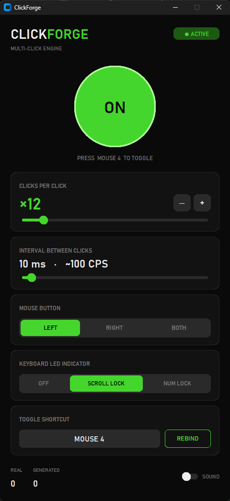
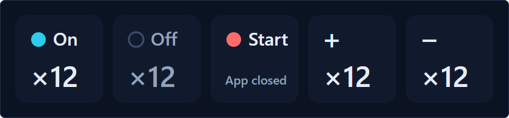

# ClickForge

ClickForge turns one mouse click into many. Set it to 12, click once, and Windows receives 12 clicks. You switch it on and off with a key, a mouse side button, or a Stream Deck key.

<p align="center">
  
</p>

## Features

- **Click multiplier** from ×1 to ×100, with an adjustable gap between clicks (1 to 200 ms).
- **Left, right, or both** mouse buttons.
- **Rebindable toggle**: any key, a key combo like `Ctrl + G`, or a mouse button (middle, Mouse 4, Mouse 5). A bound mouse button stops doing its normal job, so Mouse 4 won't trigger "Back" in your browser.
- **Works mid-game**: the shortcut fires while you hold Shift, W, or any other key.
- **Keyboard LED indicator**: Scroll Lock (or Num Lock) lights up while ClickForge runs. You can see it even in exclusive-fullscreen games, where no on-screen overlay can draw.
- **Stream Deck plugin** with live keys (below).
- **Sound cue** on toggle, and a live counter of real and generated clicks.

Clicks on the ClickForge window itself stay single, so the ON button doesn't fire twelve times. A burst also stops when your cursor reaches the window, so you can get to the OFF button during a long one.

## Stream Deck

<p align="center">
  
</p>

The plugin adds three actions: **Toggle**, **Clicks +1** and **Clicks −1**. The keys show the current state and multiplier, and they update when you toggle from the keyboard or the app too. If ClickForge isn't running, the Toggle key shows START and launches it.

## Install

**App:** download `ClickForge.exe` from [Releases](../../releases) and run it. Settings live in `%APPDATA%\ClickForge\config.json`. If you start it twice, the second start brings the open window forward.

**Stream Deck plugin:** download `com.a2m33.clickforge.streamDeckPlugin` from Releases and double-click it. Then drag the ClickForge actions onto your keys. Run `ClickForge.exe` once first so the START key knows where the app lives.

## Build from source

Requires Windows 10/11 and Python 3.10+.

```bat
pip install -r requirements.txt
python clickforge.py
```

`build.bat` packs a single `dist\ClickForge.exe` with PyInstaller.

For the plugin, you need Node.js. `streamdeck\install.ps1` installs its one dependency (`ws`), copies it into Stream Deck and restarts the Stream Deck app.

`clickforge_core.py` holds the logic with no hooks or UI, so the tests run on any OS:

```bat
pip install pytest
python -m pytest
node --test tests/plugin_logic.test.js
```

## How it works

- A low-level Windows mouse hook (`pynput`) watches real clicks. On release, a worker thread sends the extra clicks with `SendInput`.
- Windows marks synthetic input with the `LLMHF_INJECTED` flag. The hook drops flagged events, so generated clicks never trigger more clicks.
- The UI uses `customtkinter`. Hook threads pass work to the Tk thread through a queue, since Tk isn't thread-safe.
- The app serves a small HTTP API on `127.0.0.1:47811` (`GET /state`, `POST /toggle`, `POST /multiplier/up|down`). POST requests need an `X-ClickForge` header. A browser can't add that header cross-origin without a CORS preflight, and the app never answers one, so a web page can't toggle the clicker. The app also refuses any `Host` other than `127.0.0.1` and `localhost`, which stops a site from pointing its own domain at your machine to get around that.
- The Stream Deck plugin (Node.js) polls that API and draws each key as an SVG.

## Notes

- Games with anti-cheat may detect or block synthetic input. Check a game's rules before you use ClickForge in it.
- To reach apps that run as administrator, run ClickForge as administrator too.

## License

[MIT](LICENSE)
